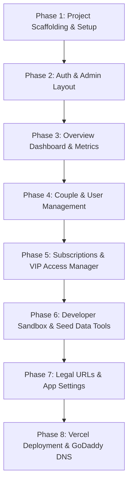

# LoveLynk Admin Dashboard — Implementation Plan

> **Scope**: Standalone Next.js 15 Admin Web Application for **LoveLynk** (`admin.lovelynk.io`), deployed on **Vercel** and connected directly to **Supabase** (`yvfolpaqchdmqdluprpo`).  
> **UI Design Reference**: Modern warm-cream dashboard frame (clean left sidebar, top admin profile bar, 4-card KPI grid with pastel accents, tabular records with approve/manage actions).  
> **Color Palette**:
> - Page Background: Warm cream (`#F9F8F4`)
> - Card Backgrounds: White (`#FFFFFF`) with borders (`#EFECE6`)
> - Pastel KPI Accents: Soft Butter Yellow (`#FEF7D6`), Soft Rose (`#FFF0F3`), Soft Mint (`#EBF8F2`), Soft Sky (`#EFF6FF`)
> - Primary Brand Accent: LoveLynk Rose/Pink (`#FF4B72`)
> - Text: Deep Charcoal (`#1E1E24`) & Muted Slate (`#64748B`)
> - Action Buttons: Charcoal pill buttons (`#1E1E24`) & Rose buttons (`#FF4B72`)

---

## Architecture & Tech Stack

- **Framework**: Next.js 15 (App Router, React 19, TypeScript)
- **Styling**: Tailwind CSS + `clsx` + `tailwind-merge`
- **Icons**: Lucide React (`lucide-react`)
- **Backend / Database**: Supabase SSR (`@supabase/ssr`, `@supabase/supabase-js`)
- **Hosting**: Vercel (Free Hobby tier)
- **Domain**: `admin.lovelynk.io` (via CNAME in GoDaddy DNS)
- **Repository**: Standalone Git repository (`lovelynk-admin`)

---

## Phase Breakdown (Subagent Execution Plan)

---

### Phase 1: Project Scaffolding & Design System Setup
*Goal: Initialize the repository, install dependencies, and configure the custom LoveLynk design system.*

- [ ] Initialize Next.js 15 project with TypeScript, App Router, and Tailwind CSS.
- [ ] Configure `tailwind.config.ts` with custom LoveLynk colors:
  - `bg-cream`: `#F9F8F4`
  - `card-border`: `#EFECE6`
  - `accent-rose`: `#FF4B72`
  - `accent-yellow`: `#FEF7D6`
  - `accent-pink`: `#FFF0F3`
  - `accent-mint`: `#EBF8F2`
  - `text-main`: `#1E1E24`
  - `text-muted`: `#64748B`
- [ ] Install dependencies:
  - `@supabase/ssr @supabase/supabase-js`
  - `lucide-react`
  - `date-fns`
- [ ] Create Supabase client and server-side utilities (`lib/supabase/client.ts`, `lib/supabase/server.ts`, `lib/supabase/middleware.ts`).
- [ ] Set up `.env.local` template:
  - `NEXT_PUBLIC_SUPABASE_URL=https://yvfolpaqchdmqdluprpo.supabase.co`
  - `NEXT_PUBLIC_SUPABASE_ANON_KEY=...`
  - `SUPABASE_SERVICE_ROLE_KEY=...`

---

### Phase 2: Authentication & Admin Layout (Design Frame)
*Goal: Implement admin authentication and build the exact layout structure from the design reference.*

- [ ] **Admin Authentication**:
  - Login page (`/login`) with email/password or email OTP.
  - Server action to authenticate against Supabase Auth.
  - Verification check: caller must exist in `public.admins` with `is_active = true`.
  - Next.js Middleware (`middleware.ts`) protecting all `/dashboard/*` routes.
- [ ] **Sidebar Navigation (Matching Design Frame)**:
  - Top: LoveLynk brand logo + title ("LoveLynk Admin").
  - Navigation links with clean Lucide icons:
    - **Dashboard** (`/dashboard`)
    - **Couples** (`/dashboard/couples`)
    - **Users** (`/dashboard/users`)
    - **Subscriptions** (`/dashboard/subscriptions`)
    - **Widgets & Interactions** (`/dashboard/widgets`)
    - **Testing & Sandbox** (`/dashboard/sandbox`)
    - **Settings & Legal** (`/dashboard/settings`)
  - Bottom: Sign out button & quick links.
- [ ] **Top Header Bar**:
  - Current date display (e.g. `4 Nov 2026`).
  - Notification icon with unread badge count.
  - Admin user pill with avatar and role (`Admin / Super Admin`).

---

### Phase 3: Overview Dashboard (KPI Cards & Recent Table)
*Goal: Build the main dashboard view with the 4-card metric grid and recent activity table.*

- [ ] **Top 4 KPI Metric Cards (Matching Screenshot Layout)**:
  1. **Monthly Revenue / Active Subscriptions**:
     - Background: Clean white / soft cream
     - Big bold metric, £ revenue calculation or active subscriber count.
  2. **Active Couples**:
     - Background: Soft Butter Yellow (`#FEF7D6`)
     - Total paired couples count.
  3. **Total Registered Users**:
     - Background: Soft white / light gray
     - Total user count in `public.users`.
  4. **Daily Widget Interactions**:
     - Background: Soft Rose (`#FFF0F3`)
     - Kisses, heartbeats, and emojis exchanged today.
- [ ] **Recent Activity Data Table**:
  - Table showing latest 10 couple pairings or subscription events.
  - Columns: Couple ID / User, Plan / Action, Amount / Status, Time (relative e.g. "2 hours ago"), Actions.
  - Action buttons: Pill buttons with `View`, `Approve`, or `Manage`.

---

### Phase 4: Couple & User Management
*Goal: Provide comprehensive tools to inspect, manage, and troubleshoot user accounts and pairings.*

- [ ] **Users View (`/dashboard/users`)**:
  - Searchable table by email, full name, or user ID.
  - Badges for status: Active, Paired, Banned, Single.
  - User details modal: Device push tokens, timezone, app version, last sign in.
- [ ] **Couples View (`/dashboard/couples`)**:
  - Table of all couples from `public.couples` and `public.couple_members`.
  - Displays: Partner A & B names, together since date, next visit date, status.
  - **Quick Action**: "Unpair Couple" (resets pairing safely for testing or support requests).

---

### Phase 5: Subscriptions & VIP Access Manager
*Goal: Real-time visibility into RevenueCat / Apple purchases and manual grant/revoke capabilities.*

- [ ] **Live Subscription Table**:
  - Queries `public.subscription_entitlements` and `public.subscription_transactions`.
  - Shows: User email, Partner email, Plan (`monthly` / `yearly`), Status (`active`, `expired`, `trial`), Expiry date, Store (`app_store`).
- [ ] **1-Click VIP / Test Grant Action**:
  - Modal or button: **"Grant LoveLynk Plus"**.
  - Allows admin to manually assign `status = 'active'`, `plan = 'yearly'`, `entitlement_id = 'plus'` for any user.
  - Instantly broadcasts `access.changed` via Supabase Realtime so the user's phone unlocks widgets immediately!
- [ ] **Revoke Action**:
  - Revokes entitlement if requested by customer support or test cleanup.

---

### Phase 6: Developer Sandbox & Seed Data Tools
*Goal: Accelerate internal QA and testing with one-click data generation.*

- [ ] **1-Click "Seed Demo Couple" Button**:
  - Creates 2 test users (`demo.partner1@lovelynk.io` & `demo.partner2@lovelynk.io`) with active pairing.
  - Pre-populates:
    - Anniversary date & countdown.
    - Pre-configured widget styles.
    - Sample distance (e.g. 5.2 miles).
    - Recent kisses and heartbeat logs.
- [ ] **Widget Interaction Simulator**:
  - Form to simulate sending a kiss (e.g. 10 kisses), heartbeat (e.g. 80 BPM), or emoji reaction to any couple ID.
- [ ] **Push Notification Dispatcher**:
  - Send a test APNs / FCM notification directly to any user's registered device token to verify push delivery and badge counts.

---

### Phase 7: Legal URLs & App Settings Manager
*Goal: Centralize management of public legal URLs and system constants stored in `public.app_settings`.*

- [ ] Edit form for `public.app_settings`:
  - `privacy_url`: `https://lovelynk.io/privacy-policy`
  - `terms_url`: `https://lovelynk.io/terms-of-service`
  - `support_email`: `info@lovelynk.io`
  - `app_store_id`: (for in-app review prompts)
- [ ] Preview button to open and verify the live legal pages.

---

### Phase 8: Vercel Deployment & GoDaddy DNS Setup
*Goal: Deploy to production with custom branded domain `admin.lovelynk.io`.*

- [ ] Connect repository to Vercel.
- [ ] Configure environment variables in Vercel Project Settings.
- [ ] Configure custom domain `admin.lovelynk.io` in Vercel.
- [ ] In GoDaddy DNS management:
  - Add CNAME record:
    - **Host**: `admin`
    - **Target**: `cname.vercel-dns.com`
    - **TTL**: 1 hour
- [ ] Verify automatic SSL certificate generation and live HTTPS response.

