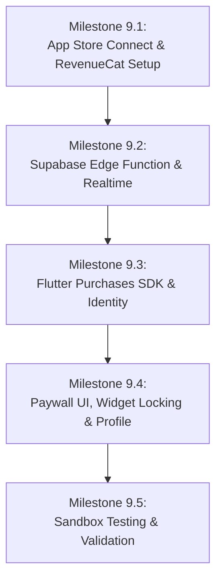

# Phase 9: Subscriptions (RevenueCat, App Store & Supabase)
## Architecture Guide & Step-by-Step Implementation Plan

---

### Executive Summary

In Lovelynk, subscriptions provide access to **LoveLynk Plus** (unlocked lock-screen widgets, custom designs, rich interactions, unlimited photos). 

A unique business requirement of Lovelynk is the **Couple-Shared Subscription**:
> **Only one partner in a couple needs to pay.** Once User A subscribes, their active partner (User B) automatically inherits full Plus access for free. User B is never prompted to pay while linked to User A.

This document outlines:
1. **Core Identity Model**: Why we use Supabase User IDs (never Device IDs) for purchases.
2. **Key Edge Cases**: Multi-account switching on the same physical phone, device switching, and unpairing.
3. **Production-Grade Reliability**: Idempotency, financial transaction logging, and StoreKit error handling.
4. **Step-by-Step Implementation Roadmap**: Apple Store Connect $\rightarrow$ RevenueCat $\rightarrow$ Supabase Edge Function $\rightarrow$ Flutter App $\rightarrow$ Sandbox Testing.

---

### 1. Identity Architecture: The "Device ID" Trap vs. Real Solution

#### The Misconception:
> *"Can we use Device ID as subscription identity?"*

#### The Reality:
- **Apple Guidelines Prohibit Device Fingerprinting**: iOS does not provide a permanent hardware ID (for privacy reasons). `identifierForVendor` changes when the user reinstalls the app, and Apple's App Store Review team rejects apps that attempt hardware tracking.
- **Apple In-App Purchases belong to the Apple ID**: In iOS, purchases are made by the Apple ID signed into iOS Settings $\rightarrow$ Media & Purchases.
- **Lovelynk Accounts belong to the Supabase User ID**: In our database, the user is identified by their UUID (`users.id`).

#### The Correct Triple-Identity Model:

```mermaid
graph LR
    AppleID["Apple ID<br/>(App Store Account)"] -->|Purchases Product| StoreKit["Apple StoreKit 2"]
    StoreKit -->|Receipt / JWS Token| RevenueCat["RevenueCat Engine"]
    SupabaseAuth["Supabase User ID<br/>(UUID: e.g. usr_123)"] -->|Purchases.logIn(uid)| RevenueCat
    RevenueCat -->|Webhook + Realtime| SupabaseDB["Supabase Database<br/>(subscription_entitlements)"]
    SupabaseDB -->|Auto-shared via Couple| PartnerUser["Partner User ID<br/>(UUID: e.g. usr_456)"]
```

1. **User Authentication**: When a user logs in, Flutter calls `Purchases.logIn(supabaseUser.id)`. RevenueCat links that user's purchases directly to their Supabase UUID.
2. **User Sign Out**: When a user logs out, Flutter calls `Purchases.logOut()`. RevenueCat clears the user's cached identity and resets to an anonymous state.
3. **Device Switching**: If User A logs into their Lovelynk account on a second device (e.g., iPhone 16), Supabase already knows they are subscribed via `subscription_entitlements`, and calling `Purchases.logIn(userA.id)` restores their RevenueCat state instantly. No extra charge, no friction.

---

### 2. Handling Critical Scenarios & Edge Cases

#### Scenario A: Two Accounts on the Same Physical Device (User A & User B)
*Situation*: User A subscribes on Device 1, logs out. User B creates an account on Device 1.
- **Physical Reality**: The iPhone still has User A's Apple ID in iOS Settings.
- **When User A logs out**:
  ```dart
  await sessionService.signOut(); // Calls Purchases.logOut()
  ```
- **When User B logs in**:
  ```dart
  await Purchases.logIn(userB.id);
  ```
- **What if User B attempts to purchase using the same Apple ID?**
  - Apple StoreKit checks the phone's App Store account and says: *"You are already subscribed to this group."*
  - In RevenueCat project settings, we configure **Restore Behavior**:
    - **Keep with original App User ID (Recommended)**: Prevents Account B from stealing Account A's subscription.
    - If User B is using their own separate Apple ID (configured via iOS Settings $\rightarrow$ App Store $\rightarrow$ Sandbox Account during testing), they can purchase their own subscription independently.
- **In Normal Usage**: If User B is User A's partner, **User B will never see the purchase button** because User B already has Plus access via the couple relationship!

#### Scenario B: Couple-Shared Subscription Mechanics
*Situation*: User A pays; Partner B joins.
1. User A buys **LoveLynk Plus Yearly**.
2. Apple charges User A; RevenueCat receives the transaction.
3. RevenueCat fires a webhook to Supabase Edge Function `revenuecat-webhook`.
4. The Edge Function writes to `subscription_entitlements`:
   ```sql
   user_id = 'user-a-uuid', status = 'active', plan = 'yearly'
   ```
5. The Edge Function queries `couples` to find User A's partner (`user-b-uuid`).
6. Supabase broadcasts `access.changed` to both `user-a-uuid` and `user-b-uuid` via Supabase Realtime.
7. Both devices execute `SessionService.to.refresh()`.
8. User B's app calls `private.get_my_access()` RPC:
   ```sql
   select * from subscription_entitlements 
   where (user_id = auth.uid() or user_id = private.partner_id())
     and status = 'active'
   ```
9. **Result for User B**:
   - `is_premium: true`
   - `source: 'partner'`
   - All widgets and premium features unlock immediately!
   - In Profile, User B sees: *"LoveLynk Plus (via [Partner Name])"*.

#### Scenario C: Couple Disconnects / Cancels Subscription
- If User A cancels: The subscription remains active until `expires_at`. On expiration, the webhook sets `status = 'expired'`. Realtime updates both phones, locking premium widgets.
- If the couple breaks up (`couple_left`): User B is no longer linked to User A. User B's `private.get_my_access()` returns `is_premium: false`. User B's widgets lock, while User A keeps their subscription.

---

### 3. Production-Grade Transactions & Payment Reliability

#### 1. Webhook Idempotency (Preventing Duplicate Charges & Revenue Corruption)
Webhooks can be retried multiple times by RevenueCat or Apple.
- `public.subscription_transactions` enforces a **`UNIQUE (revenuecat_event_id)`** constraint.
- The Edge Function checks if `event_id` already exists. If yes, it logs and immediately returns `200 OK` without creating duplicate rows or recalculating metrics.
- Financial audit records survive user deletion (`on delete set null`).

#### 2. Client Payment Error Handling (Flutter)
Never show a generic "Error occurred" alert. RevenueCat provides specific error codes:
| Error Code | User-Facing Action |
|---|---|
| `purchaseCancelledError` | Do nothing / dismiss silently. The user simply changed their mind or closed the Face ID sheet. |
| `paymentPendingError` | Show notice: *"Your purchase is pending approval (e.g., Ask to Buy or bank 2FA verification)."* |
| `productAlreadyPurchasedError` | Show notice: *"You already own this subscription. Restoring your access..."* and call `restorePurchases()`. |
| `networkError` | Show snackbar: *"Unable to connect to the App Store. Please check your internet connection."* |
| `storeProblemError` | Show snackbar: *"The App Store is experiencing temporary difficulties. Please try again later."* |

---

### 4. Phase 9 Step-by-Step Implementation Roadmap



#### Milestone 9.1 — External Configuration (App Store Connect & RevenueCat)
1. **App Store Connect**:
   - Confirm **Paid Applications Agreement** is active (Banking & Tax info entered).
   - In Subscriptions, create Subscription Group: **LoveLynk Plus**.
   - Create 2 Auto-Renewable Subscriptions:
     - `lovelynk_monthly`: £6.99 / month with a **7-Day Free Trial** (Introductory Offer).
     - `lovelynk_yearly`: £29.99 / year with a **7-Day Free Trial** (Introductory Offer).
   - Create App Store In-App Purchase Key (`.p8` file) in Keys $\rightarrow$ In-App Purchase.
2. **RevenueCat Dashboard**:
   - Create project "LoveLynk".
   - Connect iOS App (Bundle ID `com.lovelynk.ios`, upload `.p8` key + Issuer ID + Key ID).
   - Create Entitlement: `plus` (or `premium`).
   - Create Offering: `default` containing:
     - Monthly package $\rightarrow$ `lovelynk_monthly`
     - Annual package $\rightarrow$ `lovelynk_yearly`
   - Set up Webhook:
     - URL: `https://<supabase-ref>.supabase.co/functions/v1/revenuecat-webhook`
     - Authorization header: `Bearer <REVENUECAT_WEBHOOK_AUTH>`

#### Milestone 9.2 — Supabase Edge Function (`revenuecat-webhook`)
1. Create `supabase/functions/revenuecat-webhook/index.ts`.
2. Verify incoming `Authorization` header matches secret.
3. Check `event_id` against `private.revenuecat_events` (Idempotent guard via `log_revenuecat_event` RPC).
4. Parse event types:
   - `INITIAL_PURCHASE` / `RENEWAL`: Upsert `subscription_entitlements` with `active`, insert into `subscription_transactions`.
   - `CANCELLATION`: Update `will_renew = false`, `cancelled_at = now()`. (Entitlement remains active until `expires_at`).
   - `EXPIRATION`: Update `status = 'expired'`.
   - `BILLING_ISSUE`: Update `status = 'billing_issue'`, `billing_issue_at = now()`.
5. Find couple partner (`private.partner_id_for(user_id)`).
6. Broadcast `access.changed` on Supabase Realtime channels for both user and partner.

#### Milestone 9.3 — Flutter SDK Integration (`purchases_flutter`)
1. Add `purchases_flutter: ^10.18.1` to `pubspec.yaml`.
2. Configure SDK in `SubscriptionService.init()`:
   ```dart
   await Purchases.configure(PurchasesConfiguration(AppConfig.revenueCatAppleApiKey));
   ```
3. Update Auth Flow (`SessionService` / `AuthService`):
   - On successful sign in:
     ```dart
     await SubscriptionService.to.logInUser(supabaseUser.id);
     ```
   - On sign out / delete account:
     ```dart
     await SubscriptionService.to.logOutUser();
     ```
4. Update `SessionService`:
   - Listen for Realtime `access.changed` broadcast on the user topic:
     ```dart
     .onBroadcast(event: SupabaseRealtime.accessChanged, callback: (_) => refresh())
     ```
   - Make `SessionService.bootstrap.value.access` the ultimate source of truth.

#### Milestone 9.4 — Paywall UI, Widget Locking & Profile
1. **Dynamic Paywall (`subscriptions_view.dart`)**:
   - Fetch live offerings from RevenueCat (`Purchases.getOfferings()`).
   - Show dynamic localized prices (£6.99, $8.99, etc.) from `storeProduct.priceString`.
   - Wire purchase flow with trial eligibility check.
   - Wire **Restore Purchases** button (`Purchases.restorePurchases()`).
   - Wire "Manage Subscription" via `Purchases.showManageSubscriptions()`.
   - Compliance: Display Terms of Use and Privacy Policy links.
2. **Locking Mechanism**:
   - Connect widgets, lock screen, and interaction customizer to `SubscriptionService.isWidgetsUnlocked`.
   - If locked: show blurred preview / lock badge; tapping opens Paywall.
   - If unlocked (either via self or partner): all features open without restrictions.
3. **Profile Screen**:
   - If user subscribed directly: Show *"LoveLynk Plus Monthly/Yearly (Renews on [Date])"*.
   - If access granted via partner: Show *"LoveLynk Plus (via [Partner's Name])"*.

#### Milestone 9.5 — Testing & Quality Assurance
- **Test Case 1 (Single User Purchase)**: Test Sandbox monthly purchase with 7-day trial. Verify `subscription_entitlements` records `active` and `trial`.
- **Test Case 2 (Couple Sharing)**: User A buys. Partner B's phone is open. Verify Partner B's widgets unlock within 3 seconds via Realtime without pressing anything.
- **Test Case 3 (Multi-Device)**: User A logs in on Device 2. Verify subscription is active immediately on Device 2.
- **Test Case 4 (Account Switching on Same Phone)**: User A logs out. User B logs in. Verify User B starts clean with no data leaks.
- **Test Case 5 (Restore)**: Delete app, reinstall, tap Restore. Verify entitlements re-sync immediately.
